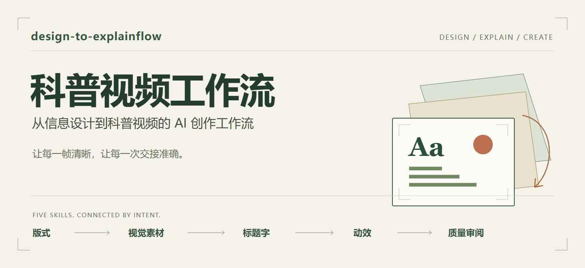

<p align="center">
  
</p>

# design-to-explainflow

**An AI creation workflow from information design to science explainer videos.**

Connect layout, visual assets, custom title lettering, motion and quality review to produce clear, accurate, reusable assets for video editing.

[简体中文](README.md) · [Getting started](#getting-started) · [Four routes](#four-production-routes) · [Skills](#five-skills) · [Example](#example-every-drop)

Use it for explanation frames, infographics, title cards, chapter cards and short motion segments, as well as covers and posters. Complete one requested stage or continue through the necessary stages within the user's authorization.

## Start with what the audience needs to understand

A useful video asset needs a reading order, a coherent visual language, accurate text and data, intentional movement, and enough editability for its next use.

The workflow connects those decisions:

**Information → layout → necessary visual assets → accurate composition → optional motion → checked delivery**

Reuse existing assets, selected directions and editable sources. Custom lettering, new image generation and animation are conditional; every request does not need every stage.

## Four production routes


| Route | Use it for | Example request | Deliverable |
|---|---|---|---|
| **A · Complete still** | Atmosphere and composition without internal editing | A text-free water-themed cover | A checked still, or a prompt when that is the requested scope |
| **B · Editable still composition** | Accurate text, data or replaceable elements | Keep the date editable and draw the exact proportions | A still export and the requested editable source |
| **C · Whole-frame motion** | Movement of a flattened image | A six-second slow push-in | The requested preview, video and/or source |
| **D · Element-level motion** | Independent control of internal elements | Emphasize each chart row during an explanation | Controllable elements, a static composite, choreography and requested motion output |

Choose **B** when accurate text or quantitative geometry needs reliable control. Choose **D** when internal elements must move independently. Editing a date does not require animation; moving a whole frame does not require layers.

Detailed Chinese guides: [static routes](docs/static-workflows.md) · [motion routes](docs/motion-workflows.md).

## Five Skills

| Skill | Its question | Handoff |
|---|---|---|
| [layout-design](skills/layout-design/SKILL.md) | What should the viewer notice first? | Hierarchy, composition, safe zones and production route |
| [image-style](skills/image-style/SKILL.md) | What visual language should the assets share? | Palette, light, material, reference roles and image prompts |
| [title-text-design](skills/title-text-design/SKILL.md) | How can the lettering carry the theme? | Lettering skeleton, per-character structure and narrative symbols |
| [motion-style](skills/motion-style/SKILL.md) | What changes, why, and when? | Early motion intent, detailed choreography, holds and implementation handoff |
| [design-review](skills/design-review/SKILL.md) | Is this artifact ready for its next stage? | Supported findings, repair locations and quality judgment |

Each Skill has an entrypoint and focused references. Ordinary typesetting does not require custom lettering. Routine creation does not automatically require the separate review workflow.

The repository supplies these five design Skills. Image generation, precise composition, animation and export require tools available in the user's environment. **imagegen and HyperFrames are not bundled.** See [capability scope](docs/compatibility.md).

## Keep the handoffs precise

- A visual master establishes style; a composite with real text and data proves the final information layout.
- Decide the motion intent before splitting assets. Design detailed timing after the static composition works.
- Preserve exact wording and quantitative geometry. Label schematic or synthetic material.
- Prefer supported native transparency; inspect actual alpha pixels and compositing edges.
- Keep quality conditions separate from user authorization. Preserve requested review points without adding unnecessary pauses.

The [manifest guide](docs/asset-handoff.md) defines coordinates, path bases and layout authority. A manifest is a handoff document unless the project actually implements a reader.

## Example: Every Drop

One brief, different delivery requirements.


| Branch | Included artifact | Evidence boundary |
|---|---|---|
| A | An atmosphere-image prompt | Preparation only; no image generation |
| B | SVG still and editable HTML source | Text, total and chart proportions can be checked |
| C | A six-second silent whole-frame push-in | Browser preview; no encoded video |
| D | An eight-second silent per-row emphasis | Browser preview and element handoff; no encoded video |
| Custom title | Lettering plan and transparency prompt | No generated title image |

The **40 / 30 / 20 / 10** values are invented demonstration data, clearly labeled in the artwork. The example demonstrates routing and asset handoff; it does not establish image-generation quality, real statistics or video-export compatibility.

[Run the example](examples/every-drop/README.md) · [Source](examples/every-drop/preview.html) · [Evidence and limits](examples/every-drop/review.md)

## Getting started

### Use the repository directly

Download it and open the folder in an agent that can read local files:

```text
Read docs/overview.md and docs/skill-index.md.
Load only the relevant SKILL.md files from skills/ and their needed references.

Create a 1920×1080 explainer still.
Exact title: “每滴有数”. Synthetic values: 40 / 30 / 20 / 10, total 100.
Keep the label “演示数据 · 不代表真实用水统计”.
The date and text must remain editable; chart geometry must match the values.
Deliver a still and editable source only, using existing HTML/SVG capabilities.
```

The expected route is **B**, an editable static composition.

### Install for regular use

Copy the five folders under `skills/` into the Skill location supported by your host. Keep `SKILL.md`, `references/` and `agents/` intact, with the five directories at the same level.

See the [installation guide](docs/getting-started.md) for Codex locations, name conflicts and invocation. Other agents require their own tool and discovery checks. The detailed workflow documentation is in Chinese; Skill instructions mix English and Chinese.

### Run the browser example

With Python 3.10+ and a modern browser, run from the repository root:

```bash
python -m http.server 8000 --bind 127.0.0.1 --directory examples/every-drop
```

Open **http://127.0.0.1:8000/preview.html**. Switch routes, edit the preview date, play or seek. The example uses plain HTML/SVG/JavaScript and makes no image- or video-generation calls.

## Documentation

[Overview](docs/overview.md) · [Static workflows](docs/static-workflows.md) · [Motion workflows](docs/motion-workflows.md) · [Asset handoff](docs/asset-handoff.md) · [Skill index](docs/skill-index.md) · [Style menu](docs/style-menu.md) · [Prompt recipes](docs/prompt-recipes.md) · [Compatibility](docs/compatibility.md)

## Validation and contributions

```bash
python scripts/check_project.py
python examples/every-drop/check_trial.py
```

The first checks project links, Skill structure, JSON/SVG and portability. The second checks static artifacts and previously captured browser observations, with negative fixtures for incorrect chart geometry, element IDs and asset paths. Neither command drives a fresh browser session or performs generation, audio synchronization or video encoding.

See [CONTRIBUTING.md](CONTRIBUTING.md). Maintain the public version here and explicitly synchronize personal installed copies.

## License and provenance

Licensed under the [MIT License](LICENSE). Copyright (c) 2026 [SalamancaDu](https://github.com/SalamancaDu). Use, modify and redistribute with the copyright and license notices retained. See [NOTICE.md](NOTICE.md) for provenance and external-tool boundaries.
