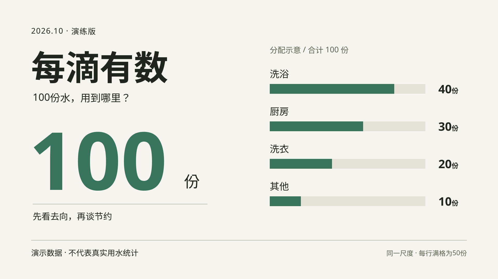

# 每滴有数 / Every Drop

一个主题，四种交付，用来理解生产路由和阶段交接。



所有数值由案例自拟，不代表真实用水统计。B/C/D 的普通标题保持可编辑；定制字形分支只提供设计与提示词。

## 本地运行

在仓库根目录：

```bash
python -m http.server 8000 --bind 127.0.0.1 --directory examples/every-drop
```

打开 `http://127.0.0.1:8000/preview.html`。

页面使用中文，包含路线切换、日期修改、播放与时间拖动。无外部前端库，不调用生成服务；系统字体可能随操作系统不同而替换。

## 可以观察什么

| 操作 | 预期行为 |
|---|---|
| 切到 A | 显示氛围图提示词与未执行生图状态 |
| 在 B 修改日期 | 只改当前预览的文字，条形长度保持 480 / 360 / 240 / 120 |
| 切到 C 并播放 | 一个整帧图像做 6 秒无声推近 |
| 切到 D 并拖动时间 | 四个行底色按窗口独立强调；文字与条形比例不变 |
| D 播放到结尾 | 在 8 秒结束，最后 2.4 秒完整停留 |

日期修改仅存在当前页面，不写回文件。需要保存时修改布局源，同时更新快照和受影响的交接字段。

## 文件关系

- [brief.md](brief.md)：准确内容、数据和四种交付条件。
- [preview.html](preview.html)：实际布局与交互源；C 使用单张整帧图，D 使用可独立寻址的 SVG 元素。
- [B/static-export.svg](B/static-export.svg)：初始静态导出快照。
- [A/image-prompt.md](A/image-prompt.md)：氛围图提示词，没有配套生成图。
- [title/title-prompt.md](title/title-prompt.md)：定制字形方案，没有配套标题 PNG。
- [C 动效说明](scenes/c01/motion-brief.md)、[D 动效说明](scenes/d01/motion-brief.md)、[D manifest](scenes/d01/scene.manifest.json)：实际交接；JSON 不被运行时读取。
- [review.md](review.md)：已取得的证据与未覆盖部分。

## 复查

```bash
python examples/every-drop/check_trial.py
```

这个脚本核对静态文件与 `browser-checks.json` 中保存的历史观察，不会重新操作浏览器。三个反例验证能否拒绝错误条形长度、不存在的元素和不存在的资产。

历史浏览器记录来自原始本地案例。换机器或修改实现后，应重新执行页面交互检查；仅重跑 Python 不能证明新环境的浏览器行为。

没有验证：实际生图、透明像素、定制字形图像、真实音频同步、HyperFrames、视频编码或最终成片。
